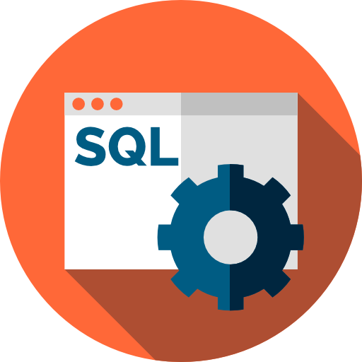

<p align="center"><a href="https://frontendmasters.com/workshops/complete-intro-sql/"></a></p>

[][fem]

<p align="center">
  Learn to construct databases, write queries, and optimize SQL with industry veteran Brian Holt.
</p>

## License

The **code** in this repo is licensed under the Apache 2.0 license.

The **content** is licensed under CC-BY-NC-4.0.

[fem]: https://frontendmasters.com/workshops/complete-intro-sql/

## Course Icon License

<a href="https://www.flaticon.com/free-icons/sql-server" title="sql server icons">SQL icons created by juicy_fish - Flaticon</a>

---

## Docker

- Run

  ```shell
  docker run -e POSTGRES_PASSWORD=lol --name=pg --rm -d -p 5432:5432 postgres:14
  ```

  - `-e`: environment variable
  - Authentication (samples)
    - `POSTGRES_PASSWORD=lol`: setting password as `lol` for the sake of simplicity
    - `--name=pg`: `pg` as in *Postgres* also for the sake of simplicity to reference later
  - `--rm`: Once this container is concluded, remove all the logs and stuff like that
  - `-d`: detach - render in the background, *don't* run in the foreground
  - `-p 5432:5432`: we expose the *port* 5432 to our local computer
  - Container information
    - `postgres`: the name of the *container*
    - `14`: the *version* of the container

  This is the hash of the container that is running (in this case)

  ```shell
  7c75e4f17ecb6d691869da3f61bda4b3e65183b0706d67cf9c512f6df5cd1d4d
  ```

- Check for the running container

  ```shell
  docker ps
  ```

  > [!TIP]
  > CONTAINER ID   IMAGE         COMMAND                  CREATED          STATUS          PORTS                                         NAMES<br>
  > 7c75e4f17ecb   postgres:14   "docker-entrypoint.s…"   11 minutes ago   Up 10 minutes   0.0.0.0:5432->5432/tcp, [::]:5432->5432/tcp   pg

- Stop

  ```shell
  docker kill pg
  ```

  Check running container

  ```shell
  docker ps
  ```

  ```shell
  CONTAINER ID   IMAGE     COMMAND   CREATED   STATUS    PORTS     NAMES
  ```

  Nothing is running

  > [!NOTE]
  > `docker kill` will delete (drop) everything that you've done
  > It's a good thing that you try to reset and start over
  > but it's a bad thing that if you don't mean to drop everything

  > [!TIP]
  > Docker is really good about just running quietly in the background
  > If you just close your laptop and come back, the docker container typically will still be running
  > Yet, restarting the computer will kill the containers

- Running in the *background* vs. *foreground*
  - Background (add the flag `-d`)

    ```shell
    docker run -e POSTGRES_PASSWORD=lol --name=pg --rm -d -p 5432:5432 postgres:14
    ```

  - Foreground (drop the flag `-d`)

    ```shell
    docker run -e POSTGRES_PASSWORD=lol --name=pg --rm -p 5432:5432 postgres:14
    ```

    Terminal

    ```shell
    2026-11-18 10:23:45.635 UTC [1] LOG:  starting PostgreSQL 14.25 (Debian 14.25-1.pgdg13+1) on aarch64-unknown-linux-gnu, compiled by gcc (Debian 14.2.0-19) 14.2.0, 64-bit
    2026-11-18 10:23:45.636 UTC [1] LOG:  listening on IPv4 address "0.0.0.0", port 5432
    2026-11-18 10:23:45.636 UTC [1] LOG:  listening on IPv6 address "::", port 5432
    2026-11-18 10:23:45.637 UTC [1] LOG:  listening on Unix socket "/var/run/postgresql/.s.PGSQL.5432"
    2026-11-18 10:23:45.639 UTC [61] LOG:  database system was shut down at 2026-11-18 10:23:45 UTC
    2026-11-18 10:23:45.642 UTC [1] LOG:  database system is ready to accept connections
    ```

  It's useful when you want to see all the logs

- Run a bash command inside of the container
  - Run

    ```shell
    docker exec -u postgres -it pg psql
    ```
    - `docker exec`: Run a bash command inside of the container
    - `-u`: run it as the postgres user
    - `-it`: interactive
    - `pg`: the name of the container
    - `psql`: the name of the command that we're running inside the container

  - Check all databases

    Type `\l` at the postgres prompt to see all the existing databases

    ```shell
    postgres=# \l
    ```

  - Exit

    ```shell
    postgres=# exit
    ```

    > [!TIP]
    > The container is still running as we're just exiting our session with the database

  You can check whether the container is still running with `docker ps`

---

## SQL Overview & Creating a Database

- The difference between SQL and Docker?
  - SQL - Structured Query Language
  - Docker

- What we are doing? We're interacting with the Postgres database with a client called PSQL
  - Postgres is a database
  - PSQL is a client that is sending queries and getting information back

  > [!TIP]
  > You can have one database but you could have many clients
  > (You could host one database but everybody else could be querying it with their own PSQLs)

- Checking for the commands
  - First: Run a bash command inside of the container

    ```shell
    docker exec -u postgres -it pg psql
    ```

  - Then at the prompt:

    ```shell
    postgres=# \?
    ```

- Tables
  - Check for existing table
    - First, as always, run a bash command inside of the container

      ```shell
      docker exec -u postgres -it pg psql
      ```

    - Then at the prompt

      ```shell
      postgres=# \d
      ```

      If you see this

      ```shell
      Did not find any relations.
      ```

      That means there are no existing tables

- A database is like a folder that contains many tables, which you can think of like spreadsheets